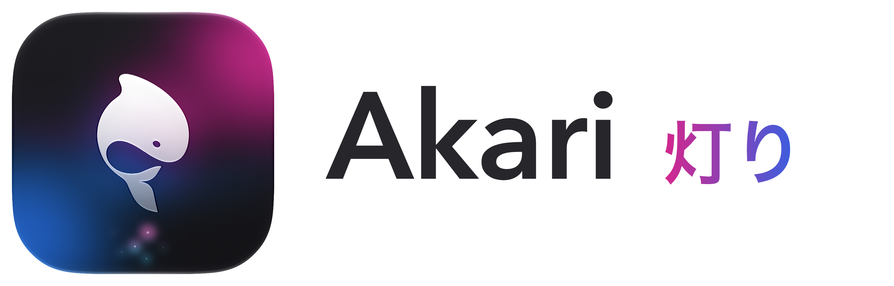

<!-- markdownlint-configure-file {
  "MD013": {
    "code_blocks": false,
    "tables": false
  },
  "MD033": false,
  "MD041": false
} -->

<div align="center">

<picture>
  <source media="(prefers-color-scheme: dark)" srcset="Branding/AkariLogo-Light.png">
  <source media="(prefers-color-scheme: light)" srcset="Branding/AkariLogo.png">
  
</picture>

###### <samp>♫ [<b>∆</b>](https://youtu.be/1XwU8H6e8Ts?si=-eokO_nbdRnAtCp9).</samp>

[](https://vimeo.com/1241690263?fl=pl&fe=sh)
> 

<samp>shot on a base M5 16GB MacBook Air, where Akari renders the Moana Island Scene at <code>~25fps</code>.</samp>

</div>

<br/>

## Quickstart: Real-Time USD Rendering

Akari can render any (`.usd`, `.usda`, `.usdc`, or `.usdz`) scene passed to the `USD_SCENE=` argument below, this repo also provides several scenes you can render immediately out of the box.

### Method 1: Download the Prebuilt macOS Release
1. **Download the Installer:** Get the latest release via the [akari_macos_arm64_installer.dmg](https://github.com/wabiverse/Akari/releases/download/v0.0.3/akari_macos_arm64_installer.dmg).
2. **Mount and Install:** Double-click the downloaded `.dmg` and drag the **AkariDemo** app bundle into your `/Applications` folder.
3. **Bypass macOS Security Warning:** Because this release is self-signed outside the Mac App Store, macOS may block it or falsely state that it is "damaged". To clear the warning, open your your Mac's **System Settings** > **Privacy & Security**, scroll down to the **Security** section, you will see a note saying *"akari was blocked..."* - click **Open Anyway**.
   > You may have to repeat this step when launching the **AkariDemo** app bundle for the first time.
5. **Run the Renderer:** Execute the compiled binary directly or from your terminal, pointing it to your chosen file path:
   ```bash
   /Applications/AkariDemo.app/Contents/MacOS/AkariDemo --usd path/to/some/scene.usda
   ```

---

### Method 2: Build and Run From Source
```bash
git clone https://github.com/wabiverse/Akari.git
cd Akari

make run USD_SCENE=Scenes/LensShowcase.usda
```
> Running this command launches the UI app which leverages the Akari PBR engine to provide interactive realtime rendering of your selected asset.

<br/>

## Overview

Akari is a realtime [**OpenUSD**](https://openusd.org/release/index.html) render engine for [**Hydra**](https://openusd.org/release/api/_page__hydra__getting__started__guide.html),
focused on speed and visual fidelity at game frame rates while rendering PBR materials. Akari can be used on every platform Swift
reaches: macOS, iOS, visionOS, Linux, Windows, and Android.

Akari is a [**Hydra Render Delegate**](https://learn.foundry.com/katana/4.5v3/dev-guide/Plugins/HydraRenderDelegates/Introduction.html)
that exists as a renderer plugin, like [**Storm**](https://openusd.org/release/api/hd_storm_page_front.html). Where Storm is USD's reference
rasterizer, Akari is a modern PBR viewport renderer meant to *look good* by default and to evolve toward a realtime game engine's needs.

## Philosophy

Modern PBR render engines look the way they do because of a stack of realtime techniques over a good rasterizer:

- **Rasterization.** Forward+/deferred PBR, image based lighting, light probes/irradiance volumes, soft & contact shadows.
- **Screen space.** GTAO, SSR, screen space GI, TAA.
- **Color pipeline.** AgX, Filmic, etc.
- **Opt-in hardware ray tracing.** RT reflections, shadows, and GI via acceleration structures.

Akari is deliberately *not* a full path tracer like [**Pixar's RenderMan**](https://renderman.pixar.com) or [**Arnold**](https://www.autodesk.com/products/arnold/overview).
Akari is designed for speed and interactivity at game framerates, and aims to match the visual fidelity of other realtime render engines such as
[**Blender's EEVEE**](https://docs.blender.org/manual/en/latest/render/eevee/index.html) and [**Google's Filament**](https://github.com/google/filament).

## Architecture

Akari builds on [**LabGL**](https://codeberg.org/meshula/LabGL) for its high level graphics interface API.

| Platform                        | Backend                     |
|-------------------------------|-------------------------------|
| macOS / iOS / visionOS            | Metal             |
| Linux / Android / Windows         | OpenGL (now) - Vulkan (later) |

## License
All files copyright (c) 2026 Wabi Foundation, and released under a BSD 3-Clause License. Certain files as noted are covered by their own licenses.

Akari builds on the following third-party frameworks, libraries, and fonts.

### High level graphics interface

**LabGL/LabFX** — an immediate-mode graphics library with a classic GL 1 API surface, by Nick Porcino
https://codeberg.org/meshula/LabGL
License: BSD 3-Clause
Credit is required if the code is distributed.

### 3D graphics framework & rendering pipeline

**OpenUSD/Hydra** — an efficient, scalable system for authoring, reading, and streaming time-sampled scene description, by Pixar Animation Studios
https://github.com/PixarAnimationStudios/OpenUSD
License: Tomorrow Open Source Technology License 1.0
Credit is required if the code is distributed.

### Rendering algorithms

**Slug** — GPU font rendering algorithm by Eric Lengyel
Reference shaders: https://github.com/EricLengyel/Slug
Paper: https://jcgt.org/published/0006/02/02/ (JCGT 2017)
License: dual MIT / Apache 2.0. The patent has been dedicated to the public domain.
Credit is required if the code is distributed.

### Tonemap operators

**AgX** — filmic tone mapping algorithm, by Troy Sobotka and EaryChow's AgXBaseRec2020
matrices, used as the default view transform in Blender and adapted from Google Filament's
minimal AgX implementation.
Reference shaders: https://github.com/google/filament/blob/main/filament/src/ToneMapper.cpp
Original AgX: https://github.com/sobotka/AgX
EaryChow's AgX: https://github.com/EaryChow/AgX_LUT_Gen
Blender: https://www.blender.org
License: Apache 2.0
Credit is required if the code is distributed.

**ACES** — ACES RRT+ODT tone mapping is adapted from Filament's ACES implementation, by Google
Reference shaders: https://github.com/google/filament/blob/main/filament/src/ToneMapper.cpp
ACES: https://github.com/aces-aswf/aces-core
License: Apache 2.0
Credit is required if the code is distributed.

**Guy ACES, Hill ACES, Narkowicz ACES** — additional ACES curve fits, by Tizian Zeltner
https://github.com/tizian/tonemapper
License: MIT

**Filmic Tonemap Operators** — filmic tonemapping operators, by Tizian Zeltner
https://github.com/tizian/tonemapper
License: MIT

**Khronos PBR Neutral** — neutral tone mapper, by the Khronos Group
Reference shaders: https://github.com/KhronosGroup/ToneMapping/tree/main/PBR_Neutral
License: Apache 2.0
Credit is required if the code is distributed.

### Text shaping

**kb_text_shape** — single-header Unicode text segmentation and OpenType shaping, by Jimmy Lefevre
https://github.com/JimmyLefevre/kb (part of the `kb` single-header library collection)
License: zlib

**FreeType** — font loading and outline extraction
https://freetype.org
License: FreeType License (BSD-style) / GPLv2

### UI and windowing

**Clay** — immediate-mode UI layout library by Nic Barker
https://github.com/nicbarker/clay
License: zlib

**RGFW** — single-header cross-platform windowing by ColleagueRiley
https://github.com/ColleagueRiley/RGFW
License: zlib

**glad2** — GL loader generator
https://github.com/Dav1dde/glad
License: generated code is WTFPL / CC0; loader itself is Apache 2.0

### Math and geometry

**GLM** — OpenGL Mathematics library
https://github.com/g-truc/glm
License: MIT

**par_shapes** — triangle mesh generation, by Philip Rideout
https://github.com/prideout/par
License: MIT

**LabCamera** — interactive camera controller, by Nick Porcino
https://github.com/meshula/LabCamera
License: MIT

**LabText** — text utilities, by Nick Porcino
https://github.com/meshula/LabText
License: MIT

**OpenVDB** — sparse volumetric data structure (used by the VoxTree demo)
https://www.openvdb.org
License: MPL 2.0

**oneTBB** — Intel Threading Building Blocks (OpenVDB dependency)
https://github.com/oneapi-src/oneTBB
License: Apache 2.0

### Fonts

**Cascadia Mono** — monospace programming font by Microsoft
https://github.com/microsoft/cascadia-code
License: SIL Open Font License 1.1

**Latin Modern** — TeX math serif family, derived from Computer Modern, by B. Jackowski & J.M. Nowacki / GUST
https://www.gust.org.pl/projects/e-foundry/latin-modern
License: GUST Font License (permissive, similar to LPPL)

**STIX Two Math** — mathematical OpenType font by the STIX Fonts Project
https://github.com/stipub/stixfonts
License: SIL Open Font License 1.1

**Noto Sans Devanagari** — Devanagari script font by Google
https://github.com/google/fonts/tree/main/ofl/notosansdevanagari
License: SIL Open Font License 1.1

### MetaverseKit distributed libraries

**Eigen**
https://github.com/libigl/eigen
License: BSD 3-Clause

**Draco**
https://github.com/google/draco
License: Apache 2.0

**ZStandard**
https://github.com/facebook/zstd
License: BSD 3-Clause

**ZLib**
https://www.zlib.net
License: zlib

**Yaml**
https://github.com/yaml/libyaml
License: MIT

**WebP**
https://github.com/webmproject/libwebp
License: BSD 3-Clause

**LZMA2**
https://github.com/conor42/fast-lzma2
License: BSD 3-Clause

**MiniZip**
https://github.com/zlib-ng/minizip-ng
License: zlib

**Blosc**
https://github.com/Blosc/c-blosc
License: BSD 3-Clause

**OpenVDB**
https://github.com/AcademySoftwareFoundation/openvdb
License: Apache 2.0

**OpenColorIO**
https://github.com/AcademySoftwareFoundation/OpenColorIO
License: BSD 3-Clause

**OpenImageIO**
https://github.com/AcademySoftwareFoundation/OpenImageIO
License: BSD 3-Clause

**MaterialX**
https://github.com/materialx/MaterialX
License: Apache 2.0

**LibPNG**
http://www.libpng.org/pub/png
License: LibPNG

**Boost**
https://github.com/boostorg/boost
License: Boost Software License

**Python**
https://python.org
License: Python Software Foundation License

**OpenSubdiv**
https://github.com/PixarAnimationStudios/OpenSubdiv
License: Apache 2.0

**OSL (Open Shading Language)**
https://github.com/AcademySoftwareFoundation/OpenShadingLanguage
License: BSD 3-Clause

**Ptex**
https://github.com/wdas/ptex
License: Apache 2.0

**ImGUI**
https://github.com/ocornut/imgui
License: MIT

**Embree**
https://github.com/RenderKit/embree
License: Apache 2.0

**Alembic**
https://github.com/alembic/alembic
License: BSD 3-Clause

**OpenEXR**
https://github.com/AcademySoftwareFoundation/openexr
License: BSD 3-Clause

**Imath**
https://github.com/AcademySoftwareFoundation/Imath
License: BSD 3-Clause

**HDF5**
https://github.com/HDFGroup/hdf5
License: HDF5 License

**TurboJPEG**
https://github.com/libjpeg-turbo/libjpeg-turbo
License: MIT

**TIFF**
https://github.com/libsdl-org/libtiff
License: Apache 2.0
